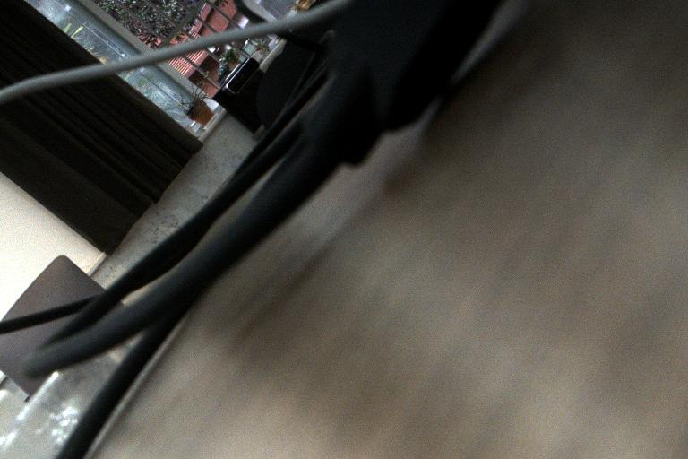

# 22 · 相机：狗上挂海康 MV-CS060，主机实时看画面

> 这份文档解决"相机插在狗上，我怎么在主机上看到它的画面"。
> 涉及：USB3 Vision 为什么不是 UVC、狗端推流服务怎么起、主机怎么看、
> 以及这一路踩出来的 5 个性能坑（都是实测数字，别凭直觉改回去）。

---

## 1. 结论先行

```
相机（MV-CS060-10UC-PRO）── USB3.2 Gen1 5Gbps ──> Go2（狗）
                                                     │  tools/mvs_stream.py
                                                     │  MJPEG over HTTP :8080
                                                     ▼
                                          主机 ./scripts/cam_view.sh
                                          浏览器 http://192.168.123.18:8080/
```

实测：**1536×1024 @ 10.4 fps，单帧 JPEG 约 46 KB，带宽约 4 Mbps**，
有线千兆下主机抓一张图 2 ms 返回。

主机抓到的实际画面（`/snapshot`，768×512 JPEG）：



---

## 2. 前提：这台相机不是 UVC

| 项 | 值 |
|---|---|
| 型号 | MV-CS060-10UC-PRO |
| VID:PID | `2bdf:0001` |
| 分辨率 | 3072 × 2048（600 万像素） |
| 协议 | **USB3 Vision**（`bInterfaceClass=239`、`bInterfaceSubClass=5`） |
| `/dev/video*` | **永不出现** |

所以：

- `cv2.VideoCapture(0)` 打不开
- `v4l2-ctl --list-devices` 看不到
- Aravis 的 `arv-viewer` 能开（它是 GenICam 协议栈），但**狗端 Aravis 0.6 有 Bayer 缺陷**，
  输出被标成 `GRAY8`，`bayer2rgb` 解错通道，画面颜色不对
- 走**海康 MVS SDK** 最省事，`/opt/MVS` 装好即可

MVS SDK 装好后必须设两个环境变量，否则 `MV_CC_Initialize()` 之后的调用会抛
`TypeError: unsupported operand type(s) for +: 'NoneType' and 'str'`
（它内部在拼路径，`MVCAM_COMMON_RUNENV` 为 None）：

```bash
export MVCAM_COMMON_RUNENV=/opt/MVS/lib
export LD_LIBRARY_PATH=/opt/MVS/lib/aarch64:$LD_LIBRARY_PATH
```

---

## 3. 狗端：起推流服务

### 一次性准备

相机插在狗的**能通的那个 USB 口**上。注意狗上有两个看起来都像 Type-C 的口，
其中一个是 device 模式（`3550000.xudc`，启动日志里 33 次 `-517` 报错），
插它没用。用下面这条确认哪个口是 host：

```bash
lsusb -t                      # 看到 5000M 那条就是
cat /sys/bus/usb/devices/2-2/speed   # 5000 = USB3
```

确认 MVS SDK 在：

```bash
ls /opt/MVS/Samples/aarch64/Python/MvImport/MvCameraControl_class.py
```

### 启动

```bash
export MVCAM_COMMON_RUNENV=/opt/MVS/lib
export LD_LIBRARY_PATH=/opt/MVS/lib/aarch64:$LD_LIBRARY_PATH

setsid python3 ~/flmap3_ws/tools/mvs_stream.py \
    --scale 4 --quality 75 --port 8080 \
    </dev/null >/tmp/cam.log 2>&1 &
```

**为什么必须 `setsid`**：普通 `nohup ... &` 在 ssh 会话结束时会被连坐杀掉
（sshd 关会话时对整个进程组发 SIGHUP）。`systemd-run --user` 也能用，但
unit 名重复会冲突，`--collect` 之后 journal 也读不到，排查反而麻烦。

### 参数

| 参数 | 默认 | 说明 |
|---|---|---|
| `--scale` | 4 | 目标宽度 = 3072/scale，4 → 768 宽 |
| `--quality` | 70 | JPEG 质量 30-95 |
| `--expo` | 30000 | 曝光微秒。**暗就加大**，室内 30000 起 |
| `--gain` | 10 | 增益 dB |
| `--binning` | 2 | 相机硬件 2×2 合并，注意**有粘性**，切回 1 不一定生效 |
| `--no-stretch` | — | 关自动对比度拉伸（默认开） |

### 出图了没有

```bash
cat /tmp/cam.log
curl -s http://127.0.0.1:8080/stats
# {"fps":10.39,"efps":10.40,"w":1536,"h":1024,"expo":30000,"gain":10.0,"frames":418}
```

`fps` 是采集帧率，`efps` 是编码帧率。**两个数应该接近**；
`efps` 明显低于 `fps` 就是编码侧被卡住了，见第 6 节。

---

## 4. 主机端：看画面

```bash
cd ~/FLMap.3
./scripts/cam_view.sh                 # 探活 + 打印地址
./scripts/cam_view.sh --open          # 顺带开浏览器
./scripts/cam_view.sh --snap now.jpg  # 存一张
./scripts/cam_view.sh --fast          # 狗端没起时，给启动命令
```

端点一览（都由 `tools/mvs_stream.py` 提供）：

| 路径 | 作用 |
|---|---|
| `/` | 网页，顶部显示帧率、分辨率、曝光 |
| `/stream` | MJPEG 流（`multipart/x-mixed-replace`） |
| `/snapshot` | 单张 JPEG，脚本 `--snap` 用的这个 |
| `/stats` | JSON 统计 |
| `/expo=60000` | 改曝光（微秒） |
| `/gain=12` | 改增益（dB） |

调曝光不用重启服务，直接在浏览器地址栏改数字即可。

---

## 5. 曝光：暗与过曝

之前有一轮误判成"相机坏了/镜头盖没摘"，其实是**曝光给太小 + 没做拉伸**。
当时的实测数据：

| 曝光 | 最亮值 | 均值 | 亮像素占比 |
|---|---|---|---|
| 15 ms | 9 | 0.07 | 0.0% |
| 50 ms | 19 | 0.32 | 0.0% |
| 200 ms | 71 | 1.47 | 0.0% |
| 999 ms + 23.9 dB | 255 | 29.27 | 24.0% |

从 15 ms 到 999 ms 是 66 倍，最亮值从 9 涨到 255 —— **传感器和光路都是好的**，
差的只是积分时间。现在默认 30 ms + 自动拉伸，普通室内就能看清桌面纹理。

判断口径：

- `/snapshot` 出来还很暗 → 加大 `--expo`（30000 → 60000 → 120000）
- 大片死白 → 减小曝光或增益
- 全黑且加到 200 ms 都没起色 → 才轮到怀疑镜头（光圈全关 / 盖子 / 滤片 / 没拧到位）

`auto_stretch` 做的是 2% / 99.5% 分位拉伸，只在暗的时候有用；场景本身有亮有暗时
它会把对比拉满，看着"发灰"，这时加 `--no-stretch`。

---

## 6. 五个性能坑（实测，别凭直觉改）

这一节是这轮调试的核心。每一行数字都是在 Go2（Jetson，`5.10.104-tegra`）上实测的。

### 坑 1：HTTP 必须多线程

`http.server.HTTPServer` 是单线程。`/stream` 一连接就**永久占住**唯一的处理线程，
于是 `/stats`、`/snapshot` 全部卡死直到超时（表现为 `curl` 拿到 `http=000`，
等满 15 秒）。换成 `ThreadingHTTPServer` + `daemon_threads = True` 立刻正常。

### 坑 2：编码只做一次

第一版让每个 `/stream` 连接自己在循环里编码。开两个浏览器就有两份编码在抢 CPU。
改成独立编码线程算一次、所有客户端共享同一份 JPEG（`png_lock` 保护），
客户端只负责把字节写出去。

### 坑 3：采集线程别复制大缓冲

```python
# 慢：每帧复制 4.5MB，在 GIL 下把编码线程挤到 1.5fps
self.frame = bytes(self.buf[:need])

# 快：零拷贝交给编码线程，只传 numpy 引用
cur[:] = _NP.frombuffer(self.buf, dtype=_NP.uint8, count=need)
self.frame = cur
```

**效果：编码帧率 1.54 → 10.38 fps**，采集 6.4 → 10.4 fps。这是提升最大的一处。

### 坑 4：降采样用抽样，不要用平均

Jetson 上纯 Python 处理图像是灾难。各种做法实测：

| 做法 | 3072×2048 耗时 |
|---|---|
| 纯 Python 四层循环 | **> 3000 ms**（一帧都编不完） |
| numpy `2×2` 平均（转 uint16 再移位） | 46.0 ms |
| numpy 纯抽样 `a[::4, ::4]` | **3.3 ms** |

**抽样快 14 倍**。暗光下平均的降噪收益远抵不上这个代价。
`downscale_rgb()` 现在只用抽样。

### 坑 5：编码用 JPEG，不用 PNG

| 编码 | 768×512 耗时 | 体积 |
|---|---|---|
| PNG + zlib level 1 | 113.9 ms | 1040 KB |
| PNG + zlib level 3 | 118.3 ms | 1040 KB |
| **JPEG q75（PIL/libjpeg）** | **2.4 ms** | **58 KB** |

**快 47 倍，小 18 倍。** 当初选 PNG 是因为"标准库 zlib 就够，不用装依赖"，
还试过手写 Baseline JPEG 编码器（Huffman 位流），出来的图 `jpegdec` 报
`no valid frames found` —— 手写编码器不可靠，别走这条路。狗上本来就装了
PIL 7.0.0 和 libjpeg，直接用。

### 顺带：相机硬件能力

探到的节点（`MV_CC_GetIntValue` / `GetEnumValue`）：

```
BinningHorizontal      ENUM  cur=1  支持的档位 2
BinningVertical        ENUM  cur=1
DecimationHorizontal   ENUM  cur=1  支持的档位 3
DecimationVertical     ENUM  cur=1
Width  min=376  max=3072  inc=4
Height min=320  max=2048  inc=2
```

- **Binning** 是硬件 2×2 平均，能把 3072×2048 直接变 1536×1024，质量好
- **Decimation** 是硬件抽样，和 Binning **互斥**（开了 Binning 再开 Decimation 会失败）
- `Width/Height` 是 **ROI 裁切**，不是缩放！设成 376×320 只留左上角一小块，
  看全场景时千万别开（`--roi` 默认 1）
- **不支持 JPEG 输出**：`SetEnumValue("PixelFormat", PixelType_Gvsp_Jpeg)`
  返回 `0x80000101`（节点不支持），12 种支持格式里没有 JPEG

---

## 7. 常见故障对照

| 现象 | 原因 | 处理 |
|---|---|---|
| `没有枚举到相机` | 相机在 device 口 / 没插稳 / 被别的进程占用 | `lsusb -t` 看 5000M；`fuser -v /dev/bus/usb/002/002` |
| `创建句柄失败` | 没调 `MV_CC_Initialize()`，或传了整个 `deviceList` | **`MV_CC_CreateHandle` 要单个 `MV_CC_DEVICE_INFO*`**，官方示例传 list 是错的 |
| `TypeError: NoneType + str` | 没设 `MVCAM_COMMON_RUNENV` | 见第 2 节 |
| `/stats` 超时、`http=000` | 单线程 HTTP 被 `/stream` 占死 | 用 `ThreadingHTTPServer` |
| `efps` 长期是 0 | 首帧还没编完 / 采集侧复制拖住了 | 看坑 3、坑 4 |
| 退出 ssh 后就断流 | 进程组被 SIGHUP | `setsid` |
| `pkill -f mvs_stream` 把自己杀掉 | 命令行里也含这个串 | 见下 |
| 画面全绿 | 不是真绿，是极暗灰度 + JPEG 近黑区伪影 | 三通道均值 7.24/8.18/7.57 几乎相等就是没光，加曝光 |

### 杀进程别用 `pkill -f`

```bash
# 危险：会匹配到 ssh 自己的命令行，把会话一起杀掉，表现为「命令无输出、Exit 1」
pkill -f mvs_stream.py

# 安全：按可执行名 + cmdline 精确匹配
for p in $(pgrep -x python3); do
  if tr "\0" " " < /proc/$p/cmdline | grep -q "mvs_stre""am.py"; then
    kill -9 "$p"
  fi
done
```

`mvs_stre""am.py` 那个拆写不是笔误 —— 合起来写，grep 自己所在的命令行也会匹配上。

---

## 8. 文件位置

| 文件 | 位置 | 说明 |
|---|---|---|
| `tools/mvs_stream.py` | 两包一致 | 狗端推流服务 |
| `scripts/cam_view.sh` | 两包一致 | 主机端查看 / 截图 |
| `scripts/dog_camera_check.sh` | 两包一致 | 狗端相机硬件体检（视频节点 / USB / i2c / Argus / xudc 五环） |
| `/tmp/cam.log` | 狗端 | 服务日志 |

`tools/mvs_stream.py` 和 `scripts/cam_view.sh` 不涉及链路细节，所以两个包里
是**同一份文件**；地址一律通过 `lib_link.sh` 的 `link_resolve` 取，不写死。
